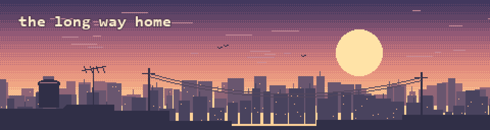

```text
$ ssh visitor@github.com
Connected to github.com (140.82.121.4)

+-----------------------------------------------------------------------+
|                                                                       |
|   _   _      _ _         __        __         _     _ _               |
|  | | | | ___| | | ___    \ \      / /__  _ __| | __| | |              |
|  | |_| |/ _ \ | |/ _ \    \ \ /\ / / _ \| '__| |/ _` | |              |
|  |  _  |  __/ | | (_) |    \ V  V / (_) | |  | | (_| |_|              |
|  |_| |_|\___|_|_|\___/      \_/\_/ \___/|_|  |_|\__,_(_)              |
|                                                                       |
|  According to all known laws of computer science, there is no way     |
|  this spaghetti code should compile. Its dependencies are too broken  |
|  to get its fat little container off the ground.                      |
|                                                                       |
|  The code, of course, runs anyway because compilers don't care        |
|  what humans think is impossible.                                     |
|                                                                       |
+-----------------------------------------------------------------------+

visitor@github.com: Permission denied (publickey).
Connection closed.
```

### Currently Building

* **PPE detection** — Spotting protective gear in industrial camera feeds.
* **Fall detection** — Using body pose to tell a fall from someone sitting down.

---
*Made on Earth by a human.*

<!--
  =========================================================
   Congratulations, you inspected the source code!

   "Made on Earth by humans — powered by caffeine."

   If you're hiring or want to collab, ping me at:
   work@faizfahmi.com
  =========================================================
-->
